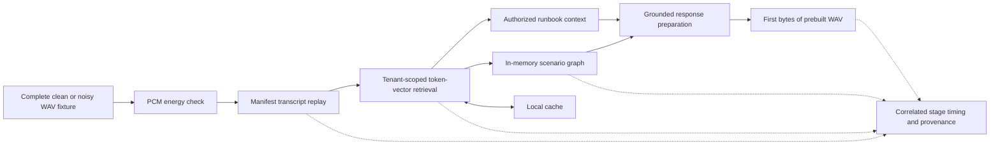

# Week 1 Reactive Baseline Architecture

## Executed boundaries

| Boundary | Week 1 execution | Remaining integration |
| --- | --- | --- |
| Speech detection | PCM energy check on complete fixtures | Live turn detection |
| Transcript | Manifest replay | Inferred streaming ASR |
| Retrieval | Tenant-scoped token-set similarity | BGE-M3 and Redis |
| Graph | In-memory scenario/state repository | NebulaGraph |
| Cache | In-memory reuse | Production scoped cache and invalidation |
| Response audio | Prebuilt WAV bytes | Generated streaming TTS |
| Instrumentation | Local correlated events | Production observability stack |

Recorded execution used CPython 3.12.5 on macOS arm64 with standard-library adapters. Proposed LiveKit, MiniCPM-o and other service integrations were not exercised by these results.

## Trust and lifecycle boundaries

The authenticated tenant limits eligible retrieval context. The runtime supports cancellation and records correlation IDs and provenance. Automated cross-tenant rejection provides bounded regression evidence, not a complete isolation audit.

Future prediction may prepare context but must not authorize access or execute actions. The design requires authorization before prefetch and again before consumption, scoped cache identity and freshness checks, and a reactive fallback. These are design requirements at Week 1 close, not claims that the full predictive control path already ran.

## Release evidence boundary

The voice workload exports application identity, configuration, graph snapshot, policy version, cases and normalized telemetry. Artifact hashes bind the exported evidence. The existing [Release Engineering Lab](../../02-llm-release-engineering/README.md) owns generic comparison and release-policy machinery. Week 1 validated bundle compatibility; it did not demonstrate promotion, canary or rollback for this voice workload.
