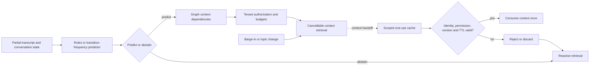

# Week 2 Predictive Context Architecture

The local components separate the prediction decision, authorized retrieval and cache consumption. The diagram shows the intended context lifecycle; the comparative benchmark is a separate model of context overlap and latency, not an execution of this entire chain.

## Predictor and graph

Both baseline adapters implement one contract: ranked next-state candidates, a probability distribution, confidence, evidence and abstention. Rules use workload state machines; transition-frequency lookup uses the frozen graph. Graph validation covers invalid states, duplicate/self edges, evidence counts and normalized outgoing probabilities.

The experiment supplies scenario and current state. It does not infer those fields from raw live speech. Partial-transcript checkpoints exercise a predict/abstain heuristic.

## Prefetch lifecycle

The orchestrator can start a background task without blocking its caller. It maps candidates to permitted context dependencies, checks each key's tenant authorization before loading, and bounds work by item count, elapsed time and simulated cost. Cancellation propagates to in-flight work. Structured outcomes distinguish accepted, rejected and cancelled work.

## Cache lifecycle

Local cache identity includes tenant, user, session, permission scope and source version. Consumption rechecks identity, current authorization, source version and TTL. A successful read removes the entry. Revoked, stale or expired values are discarded; a foreign identity is rejected without removing the owner's entry. Targeted invalidation and lifecycle counters support inspection.

These are local component behaviors with automated coverage. They do not establish distributed Redis semantics or full live voice integration.

## Evaluation and release boundaries

The paired replay calls a predictor, maps candidate states to context dependencies, and computes overlap with expected dependencies. It models cache reads and reactive fetches using fixed costs. It does not call the prefetch orchestrator or scoped cache and does not exercise their authorization, expiration or cancellation checks during the 200-turn comparison.

The Week 1 Release Lab workload contract remains reusable. Week 2 predictive candidate exports, lifecycle metric adapters, hard-gate integration and Release Lab paired comparison remain open in the tracker. No voice-candidate promotion decision is reported.
