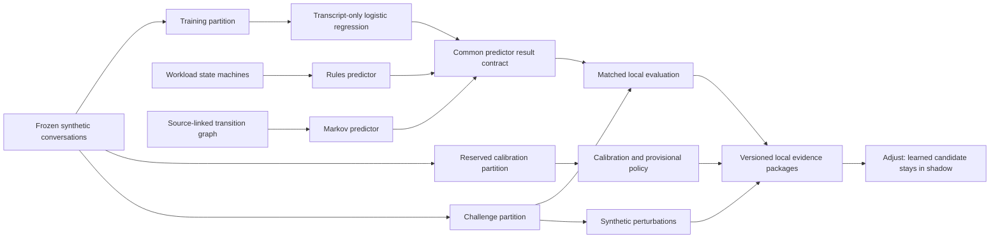

# Week 3 Predictor Comparison Architecture

## Different information boundaries

The learned candidate extracts features from transcript text only. Rules and Markov use supplied scenario and current-state information derived from workload/graph structure. They share a result interface, but do not solve an equal-information prediction problem. Their resistance to transcript edits does not establish superior speech understanding.

## Calibration and abstention

A reserved partition supports reliability bins, multiclass Brier score and expected calibration error. A separate policy component can abstain on low confidence, unfamiliar vocabulary or unknown risk. Thresholds remain provisional on the small synthetic split. Matched base-case scores and perturbation scores are not evidence that this policy prevents the observed high-confidence errors in a live runtime.

## Jev adapter boundary

The adapter maps bounded scenario choices to the common result contract. It is restricted to shadow mode and returns abstention on failures or unusable choices. Injected-client tests cover error handling; no real provider output was collected. Generated option variants are test inputs awaiting evaluation, not robustness results.

## Evidence and release boundary

The local finalizer writes matched outputs, summary metrics, scenario checks and hashed manifests for rules, Markov, learned and Jev candidates. The Jev package explicitly contains no matched outputs and records insufficient evidence.

Inspection of the finalizer establishes local comparison and packaging, not execution by the sibling Release Lab. A schema-version label alone does not establish contract acceptance. The tracker leaves identical held-out evaluation of every candidate through that framework open. Keep local evidence, framework validation and activation authority distinct.
